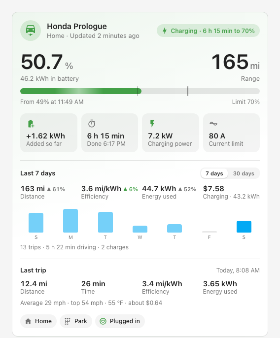
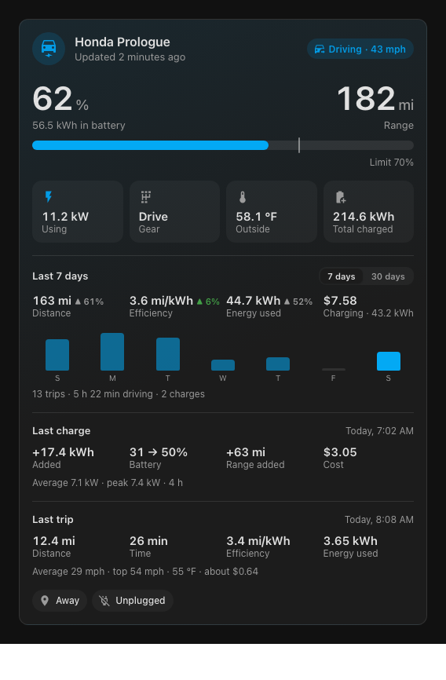
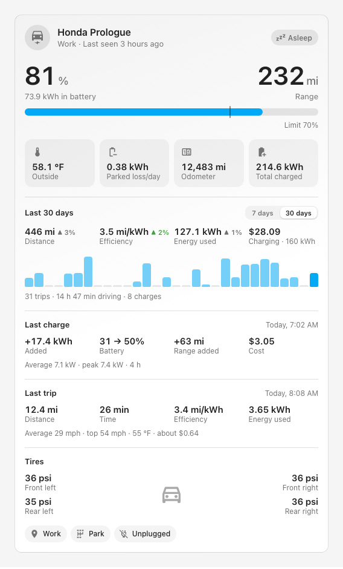
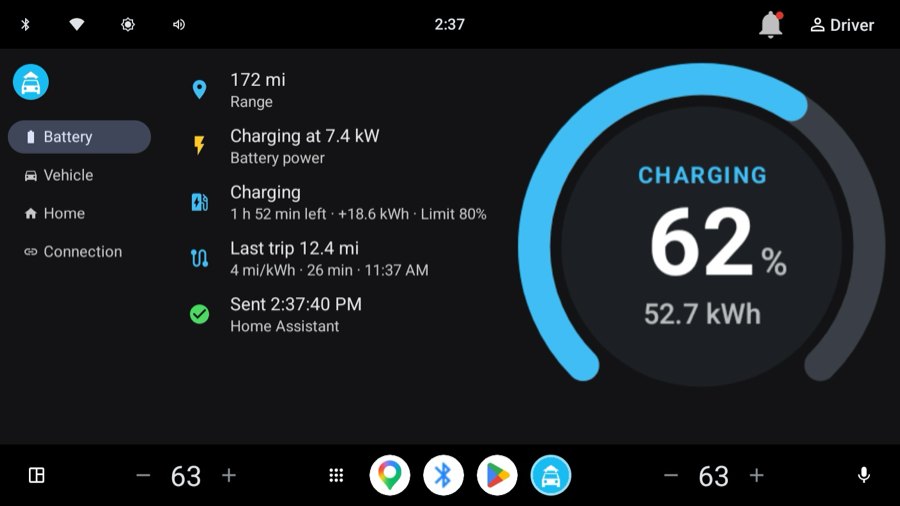
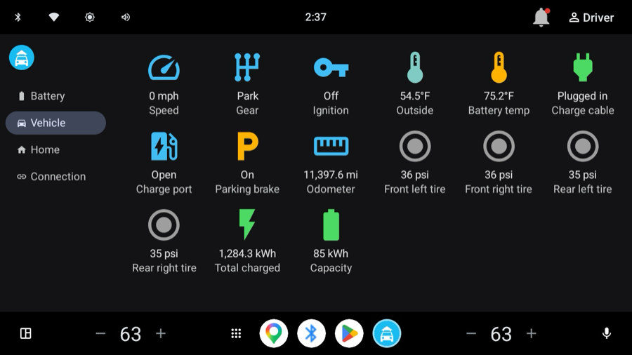
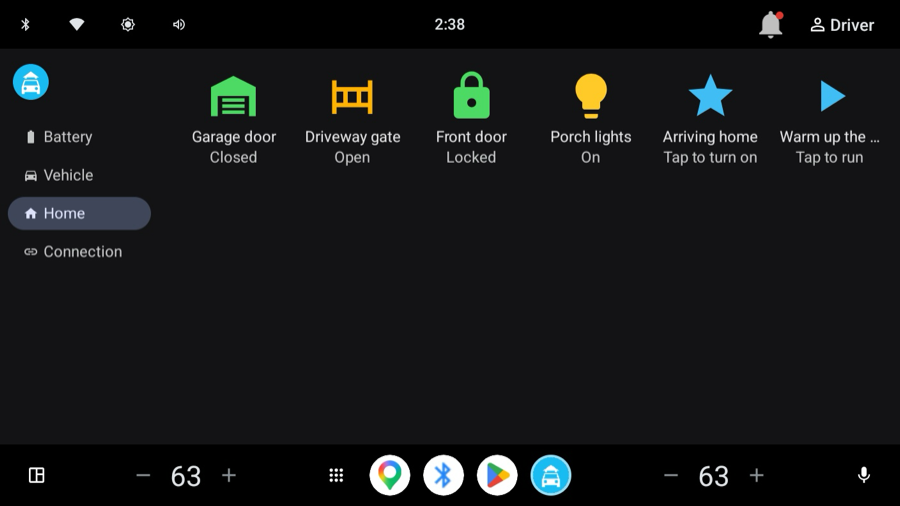
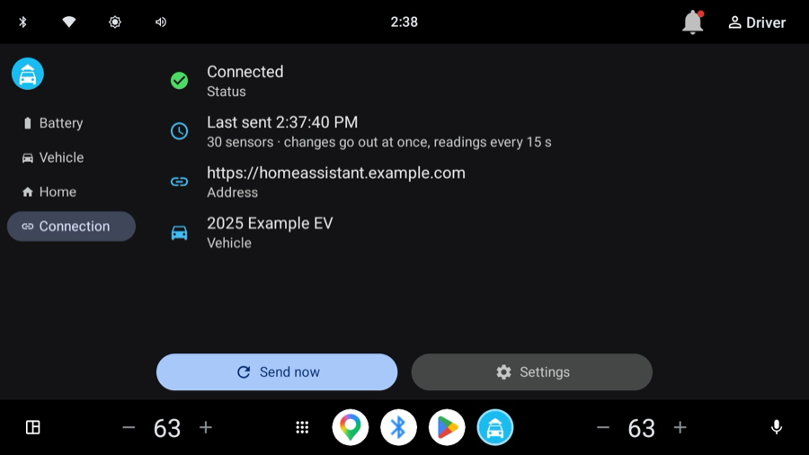

# Car Bridge Card

[](https://hacs.xyz/docs/faq/custom_repositories/)

A Home Assistant dashboard card for a car that **Car Bridge** sends to Home Assistant: battery and
range, charging, driving, the last trip, tire pressures and where the car is, on one card that
follows your theme.

| Charging | Driving (dark theme) | Asleep, with tire pressures |
|---|---|---|
|  |  |  |

## Car Bridge

Car Bridge is an app for the car's own screen. It runs on cars with Google built-in (Android
Automotive OS with Google Play) and sends the car's data straight to your Home Assistant. The car
shows up as a device, the same way the Home Assistant companion app does on a phone, so there is no
YAML, MQTT or cloud service to set up, and no account other than your Home Assistant.

- **Sensors** in Home Assistant's own units (mi or km, °F or °C):
  - **Battery and range:** battery level and energy, battery power (worked out from the battery's
    energy readings on cars that don't report it, such as the Honda Prologue), range.
  - **Charging:** charge state, plugged in, charge port, time remaining, charge limit, charge current limit.
  - **Driving and climate:** speed, gear, ignition, parking brake, outside and battery temperature.
  - **Gas and hybrid cars:** fuel level and fuel door.
  - **If the car shares them:** odometer and tire pressures.
- **Energy charged** for the Energy dashboard.
- **Charge session:** each charge's energy added, levels, range gained, and average and peak power.
- **Last trip:** distance, time, efficiency, energy used, speeds and outside temperature.
- **Parked loss:** energy lost while the car sits parked, also as a daily rate.
- **Car data:** a diagnostic listing the values the car doesn't share.
- **Events** for automations when a charge or a trip starts and ends.
- **Last update**, so you can tell fresh data from a sleeping car's last values.
- **Location** (optional, off until you turn it on), for zones like arriving home.
- **Notifications:** `notify.mobile_app_<car>` shows your Home Assistant messages on the car screen.
- **Home tab:** give garage doors, gates, locks, lights or scenes the label **Car Bridge** and they
  appear as buttons on the car screen. Unlocking asks first.
- **Sign-in:** your Home Assistant username and password (two-factor codes work), or a long-lived
  access token.

| Battery | Vehicle |
|---|---|
|  |  |
| **Home** | **Connection** |
|  |  |

The car's data goes only to the Home Assistant you sign in to. Car Bridge has no analytics and no
servers of its own.

**Cars:** any car with Google built-in where Google Play is on the car's screen. It was tested on a
2025 Honda Prologue. Cars with Google built-in include:
- Polestar 3, 4 and 5; Volvo EX30, EX90 and ES90
- Chevrolet Equinox EV, Blazer EV and Silverado EV; Cadillac Lyriq, Optiq and Escalade IQ; GMC Hummer EV and Sierra EV
- Honda Prologue and Acura ZDX
- Nissan Ariya and Leaf (2026 on); Renault 4, 5 and Mégane

Equipment depends on the model year and country. Cars whose Android Automotive has no Google Play
(BMW, Audi, Porsche, Rivian, Lucid) can't install it. CarPlay and Android Auto only mirror a phone,
so they aren't enough either.

**Availability:** Car Bridge is in testing on Google Play and isn't publicly listed yet.

## The card

- **Status at a glance:** charging (time left and finish time), driving (speed), plugged in, charged,
  parked or asleep. The card's accent color follows the status.
- **Battery and range** with a bar that marks the charge limit and, while charging, where the
  charge started. Gas cars show fuel instead; hybrids show both.
- **Tiles that change with the situation:**
  - Charging: energy added, time left, charging power and current limit.
  - Driving: power used or regenerated, and the gear.
  - Parked: outside temperature, parked loss per day, odometer, total charged and battery capacity.
- **The last 7 or 30 days**, switchable on the card:
  - Distance, efficiency, energy used, and energy charged or its cost.
  - How each compares with the 7 or 30 days before.
  - Distance per day as bars, and the number of trips, time driving and charges.
- **The last charge:** energy added, battery levels, range added, cost or time, and average and
  peak power.
- **The last trip:** distance, time, efficiency and energy used, then average and top speed, outside
  temperature and about what it cost.
- **Tire pressures** and **status chips** (location, gear, plug, open charge port or fuel door).
- **Costs:** give the card your electricity price, as a number or a sensor. Car Bridge measures what
  went into the battery, and a home charger loses about 10% on the way, so costs are worked out from
  that energy ÷ 0.9 (change it with `charge_efficiency`).
- **History on tap:** tap any value to open it. The header opens the car's location.
- **Fits anywhere:** it uses your theme in light and dark, your number and time formats, and a
  two-column layout on narrow screens.

When the car hasn't reported for 20 minutes, the card says **Asleep**, because the head unit has gone
to sleep and the values shown are the last ones it sent.

The summary is read from Home Assistant's history. Home Assistant keeps 10 days of history unless
`purge_keep_days` in the `recorder` settings says otherwise, so the 30-day view and its comparison
need 60 days kept. Parked loss, range added and average power need Car Bridge 0.2.2 or later.

### Install with HACS

1. In HACS, open ⋮ › **Custom repositories**, add `https://github.com/kkrankall/car-bridge-card`
   with the type **Dashboard**.
2. Find **Car Bridge Card** in HACS and download it.
3. Reload the browser.

### Install by hand

1. Copy `car-bridge-card.js` to `/config/www/`.
2. Go to Settings › Dashboards › ⋮ › **Resources** › **Add resource**. Enter the URL
   `/local/car-bridge-card.js?v=1.1.0` with the type **JavaScript module**.
3. Raise the `?v=` number whenever you replace the file, or browsers keep using the old one.

### Add it to a dashboard

Edit a dashboard, add the **Car Bridge** card, and choose any of the car's sensors. The card finds
the car's other entities from that one, even if you renamed them. In YAML:

```yaml
type: custom:car-bridge-card
entity: sensor.my_car_battery_level
```

| Option | Default | |
|---|---|---|
| `entity` | (required) | Any of the car's entities, usually its battery level |
| `name` | the device name | Name shown on the card |
| `show_stats` | `true` | Show the 7 and 30 day summary |
| `show_charge` | `true` | Show the last charge |
| `show_trip` | `true` | Show the last trip |
| `show_tires` | `true` | Show tire pressures, when the car reports them |
| `show_chips` | `true` | Show the status chips |
| `stats_period` | `week` | Which summary shows first: `week` (7 days) or `month` (30 days) |
| `price` | (none) | Electricity price per kWh, in your Home Assistant currency |
| `price_entity` | (none) | A sensor or input_number with the price, instead of `price` |
| `charge_efficiency` | `0.9` | Share of the energy from the wall that reaches the battery |

Needs Home Assistant 2024.11 or later.

## License

MIT
